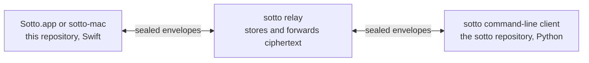
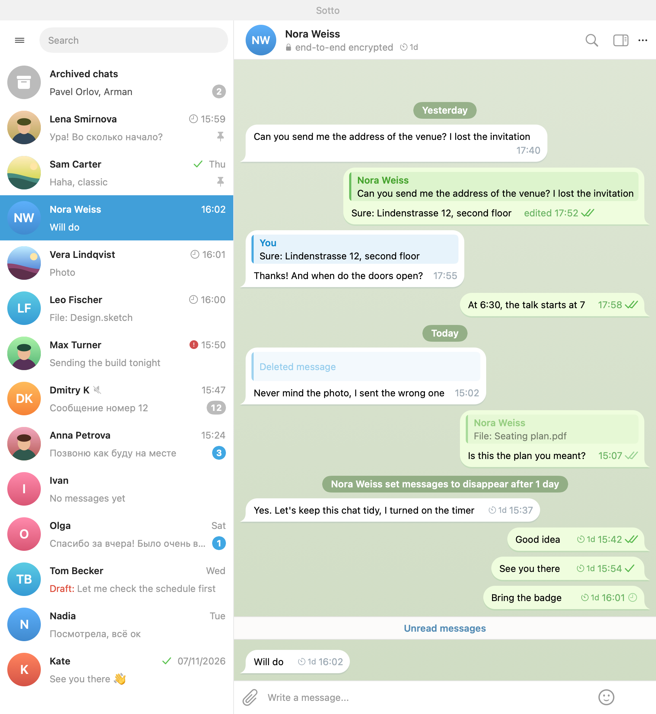
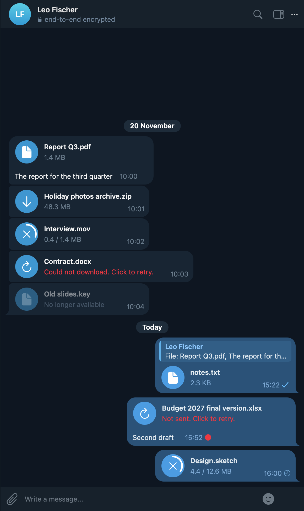
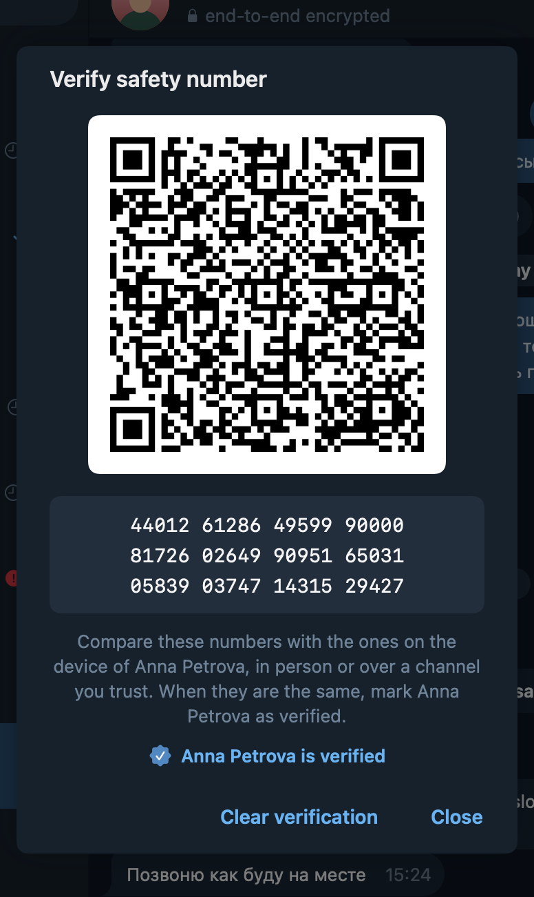

<p align="center">
  
</p>

<h1 align="center">sotto-mac</h1>

<p align="center">
  <b>A native macOS client for sotto, an end-to-end encrypted one-to-one messenger.</b><br>
  The relay in the middle passes sealed messages along and holds no key that opens them.
</p>

<p align="center">
  
  
  
  <a href="LICENSE"></a>
  <a href="https://github.com/GlowyStar/sotto"></a>
</p>

<p align="center">
  <a href="#screenshots">Screenshots</a> |
  <a href="#features">Features</a> |
  <a href="#status-and-security">Security</a> |
  <a href="#build-and-run">Build and run</a> |
  <a href="#interop-with-sotto">Interop</a> |
  <a href="docs/app.md">The app in detail</a> |
  <a href="docs/key-storage.md">Key storage</a>
</p>

---

sotto-mac is the Mac side of [sotto](https://github.com/GlowyStar/sotto). The sotto repository
holds the protocol, the relay, the threat model, the shared test vectors and the reference
command-line client in Python. This repository implements the same protocol in Swift and has to
interoperate with sotto's command-line client byte for byte. One core, `SottoCore`, serves two
programs, the SwiftUI app `Sotto` and the command-line tool `sotto-mac`.



There is no phone number and no account. An identity is a key pair made on the Mac, and a contact
is added by its user id under a local name.

> [!WARNING]
> **An alpha, not audited.** Nobody has reviewed this code for security, so do not trust it with
> anything that matters. [What it protects and what it does not](#status-and-security).

## Screenshots

<p align="center">
  
</p>

<table>
  <tr>
    <td width="50%" valign="top">
      
      <br><sub>Files of up to 100 MiB, with transfers that resume after a cut connection or a restart.</sub>
    </td>
    <td width="50%" valign="top">
      
      <br><sub>The safety number of a contact, its QR code and the verified mark.</sub>
    </td>
  </tr>
</table>

The app draws these itself from its mock data: `Sotto --snapshot <folder>` renders a fixed set of
window states into PNG files and exits.

## Features

- **Post-quantum key agreement.** New sessions are agreed by PQXDH: X25519 together with
  ML-KEM-768 of CryptoKit (part 6 of the protocol, end-to-end version 2).
- **Double Ratchet** for the messages of a session (part 2 of the protocol).
- **Photos and files of up to 100 MiB**, encrypted on the Mac with the blob cipher, uploaded and
  downloaded in pieces that resume after a cut connection or a restart (part 3). Attach, drop or
  paste them; a photo opens in a viewer with zoom.
- **Profile.** A display name and an avatar, sent encrypted to every contact with a session (part 4).
- **Replies, edits and delete for both.** A reply quotes the message; an own message can be edited
  up to ten times within a day of sending (part 5).
- **Delivery and read receipts.** A clock while a message waits, one check once the relay stored
  it, two once the contact's app has it, two in the full colour once the contact has seen it. Read
  receipts can be turned off.
- **Disappearing messages**, set per chat, from 30 seconds up to 4 weeks.
- **Safety numbers.** 60 digits and a QR code computed from the two identity keys, as libsignal's
  numeric fingerprint, and a verified mark that never leaves the Mac (part 7). A second encryption
  key signed by a contact's identity is refused, and the chat says so.
- **Encrypted at rest.** SQLCipher over the whole store, its random 256-bit key wrapped to a Secure
  Enclave key of the Mac that asks for Touch ID or the Mac password. Drafts, settings, pasted
  pictures and received files are kept inside it too.
- **Locks by itself** after the auto-lock time (5 minutes by default), on Cmd+L, on sleep and when
  the screen of the Mac locks, and overwrites the store key in memory.
- **Quiet notifications.** By default a notification says only "New message" from "Sotto", with no
  name and no text.
- **Hidden chats.** A chat can be moved behind a phrase into a second encrypted file; only the
  phrase typed into the search brings it back, and every Mac has that file, used or not.
- **Search** across chats and inside the open chat, all on the Mac.
- **A command-line tool**, `sotto-mac`, with the commands of sotto's own `sotto` and the same
  encrypted store.

How each of these behaves in the app, step by step: [docs/app.md](docs/app.md).

## Status and security

- **An alpha.** The app and `sotto-mac` chat with sotto's command-line client through a sotto
  relay in both directions, with every feature above, and two scripts check that end to end
  ([Interop with sotto](#interop-with-sotto)).
- **Not audited.** Nobody has reviewed this code for security.
- **What the post-quantum part covers.** The key agreement of new sessions only, so the recorded
  messages of such a session stay closed to a later quantum computer. The Ed25519 signatures over
  the prekeys are classical, so an attacker who has such a computer at the time of the session and
  sits in the middle is not stopped; the ratchet is the classical Double Ratchet, so healing after
  a compromise is not post-quantum either
  ([sotto's threat model](https://github.com/GlowyStar/sotto/blob/main/docs/threat-model.md#post-quantum-protection)).
  Sessions made by X3DH before keep working with version 1 and stay open to it; no new one is made
  either way: a bundle without a post-quantum prekey ends in `PQ_PREKEY_MISSING`, a new session of
  version 1 in `X3DH_REFUSED`.
- **What the relay sees.** It cannot read a message, but it sees who talks to whom, when and how
  much ([what the relay learns](https://github.com/GlowyStar/sotto/blob/main/docs/threat-model.md#what-the-relay-learns),
  in sotto's threat model).
- **Hidden chats are hidden on this Mac only.** The relay still sees who writes to whom, the contact
  sees no delivered mark while the hidden chats are closed, and the size of their file can hint
  that it is used ([key storage](docs/key-storage.md#hidden-chats)).
- **Delete for both and the timer are requests** that the other side's client honours. Nothing
  can make it do so, nothing proves that it did, and nothing protects a message from the person
  who received it.
- **The presence check** stops someone at the keyboard who does not know the Mac password, and any
  copy of the store taken to another Mac or read offline. It does not stop code that runs as the
  user: such code can ask for the same sheet in Sotto's name, wait for the next normal unlock, or
  read what the window shows while Sotto is unlocked. Whoever knows the Mac password gets the
  chats, and a Time Machine backup or a local snapshot of the data folder opens on this Mac with it.
- **What leaves the store is readable:** a copy made with "Save as...", a file opened in another
  app, what "Copy" puts on the pasteboard until a lock, and, with the name or the preview turned on,
  what macOS keeps of each notification.
- **Safety numbers are compared by reading them.** The Mac does not scan a QR code.
- **A plain `ws://` address is dialed only to a loopback host**; a relay on another machine belongs
  behind TLS and is dialed as `wss://`.
- **One device per identity.** When the same identity logs in elsewhere, the relay closes the older
  connection and the app says so instead of reconnecting.

Where every key lives and what is written outside the store: [docs/key-storage.md](docs/key-storage.md).
The full list of limits: [docs/app.md](docs/app.md#limits).

## Build and run

Needs macOS 26 or later (for ML-KEM-768 of CryptoKit) on a Mac with a Secure Enclave (Apple silicon
or a T2 chip), and Swift 6: Command Line Tools are enough, Xcode is not needed. SwiftPM fetches
SQLCipher 4.20.0, Zetetic's official Swift package, a binary framework that `scripts/build-app.sh`
copies into the app.

```sh
swift build                 # all targets
scripts/test.sh             # the tests (Swift Testing)
scripts/build-app.sh        # build/Sotto.app, signed ad hoc with the hardened runtime
open build/Sotto.app
swift run sotto-mac         # the command-line tool
```

The app starts locked and opens its store after the system sheet of Touch ID or the Mac password.
The first launch makes the identity and shows its user id; later launches open the chat list. A
contact is added by its user id under a local name, from the menu at the top of the list.

### The command-line tool

`sotto-mac` has the commands of sotto's `sotto`. Its identity lives in `~/.sotto-mac` unless
`--data-dir` names another directory, in the same encrypted store as the app's, and each command
asks for Touch ID or the Mac password once:

```sh
sotto-mac init                      # make an identity, print its user id
sotto-mac add bob <user id>         # add a contact under a local name
sotto-mac contacts
sotto-mac chat bob --relay ws://127.0.0.1:8765/ws   # /quit or end of input ends
sotto-mac reset bob                 # start a new session with bob
sotto-mac send-file bob photo.jpg --caption "hi"   # waits until it is sent or not sent
sotto-mac read-receipts [on|off]    # show or set the read receipts contacts get
sotto-mac verify bob [mark|clear]   # the safety number with bob; mark or clear the mark
```

`chat` prints every message with its number in the log (`#12 bob: hi`), the marks of the own ones
(`#12 sent`, `#12 delivered`, `#12 read`) and one line when the contact edits or deletes a message
or changes the timer; a printed message counts as read. It takes the commands of sotto's `chat`:
`/reply N text`, `/edit N text`, `/delete N` (for both sides) and `/timer [off|30s|5m|1h|1d|1w]`.

Received files are saved, readable, into the folder `received` of the data directory (a console
has no viewer: the file is its output; the app keeps them inside its store), under the name the
sender gave when it is a plain file name, never over a file that is there. A file whose sending
stopped goes on at the next `chat` or `send-file`. A `ws://` URL is dialed only to a loopback host
unless `--insecure` is given.

### Run the app against a relay

The app needs a sotto relay. Start the one of the sotto project, checked out at
`../../python/sotto` here, either with Docker or with its console script; both take the port
explicitly, and the app and the clients below dial that port:

```sh
cd ../../python/sotto
RELAY_PORT=8784 RELAY_METRICS_PORT=9784 docker compose up --build -d --wait
# or: RELAY_DATABASE=relay.db RELAY_PORT=8784 uv run sotto-relay
```

Then start the app on its own data directory and that relay:

```sh
scripts/build-app.sh
build/Sotto.app/Contents/MacOS/Sotto \
    --data-dir /tmp/sotto-app --relay ws://127.0.0.1:8784/ws
```

A store of another data directory asks for Touch ID or the Mac password as well; only
`SOTTO_STORE_PROTECTION=test` in the environment, which the tests and the check scripts set, makes
one that asks nothing, and the default folders refuse it. Dial the relay as `127.0.0.1`, not
`localhost`: the relay of `compose.yaml` refuses a login signed for another host name.

To talk to the app from sotto's command-line client, give each side the other's id:

```sh
cd ../../python/sotto
uv run sotto --data-dir alice init                      # prints alice's id
uv run sotto --data-dir alice add app <the app's id>
uv run sotto --data-dir alice chat app --relay ws://127.0.0.1:8784/ws
```

The same works with this repository's own tool, which speaks the same protocol:

```sh
swift run sotto-mac --data-dir /tmp/bob init
swift run sotto-mac --data-dir /tmp/bob add app <the app's id>
swift run sotto-mac --data-dir /tmp/bob chat app --relay ws://127.0.0.1:8784/ws
```

An identity can receive once its client has connected one time, because that is when its prekey
bundle reaches the relay: start the app before the first message to it. A message from someone who
is not a contact is dropped. Every launch argument of the app is listed in
[docs/app.md](docs/app.md#launch-arguments).

## Interop with sotto

Two scripts run this repository against sotto's own command-line client through a real sotto relay
from a checkout at `../../python/sotto`. Both keep their data in a temporary directory that they
remove at the end; `--keep DIR` leaves the stores, the relay database and the pictures in DIR.

```sh
# sotto-mac and sotto's client
../../python/sotto/.venv/bin/python scripts/interop.py [--keep DIR]
# the built app and sotto's client
../../python/sotto/.venv/bin/python scripts/app-interop.py [--keep DIR]
```

- `scripts/interop.py`: `sotto-mac` and sotto's client chat both ways, also after restarts of
  either side; files go both ways, two of them cut in the middle.
- `scripts/app-interop.py`: the built app and sotto's client, through the real app process and a
  relay on a free port. sotto's client writes to the app while it runs and while it is closed; the app sends with `--send` to the
  running client, right after a restart and while the client is away; a photo and a file go each
  way and are compared byte for byte, the received ones as the store keeps them; a large upload and
  a large download of the app are each cut by killing the app in the middle and end whole after its
  next start; the profiles go both ways.
- Both scripts make a PQXDH session in each direction, exercise a reply, an edit, a delete for
  both, the read marks and a message under a short timer each way, and check that each side shows
  the safety number of sotto's client; the app keeps its verified mark through the run.
- After the run, `scripts/app-interop.py` checks that no file of the app's data folder holds a text
  or a file of the run in the clear, then a dump and a snapshot of its store; last the app itself:
  the hardened runtime of its signature, a `DYLD_INSERT_LIBRARIES` that it ignores, the scripting
  flags refused on a store of the presence kind, and a lock on the first-launch screen that closes
  the store.

### Tests

`scripts/test.sh` runs the Swift Testing suite under Command Line Tools: crypto against the vectors,
wire fixtures of the reference, the store, the session, the transport against a scripted and a
hostile relay, and the app layer. Part of it starts the relay of the sotto checkout and is skipped
when that checkout is missing.

- The core replays every vector of sotto's `vectors/pqxdh.json`. ML-KEM encapsulation is randomized
  and CryptoKit takes no fixed randomness, so the vectors of the initiator are replayed with the
  recorded ciphertext and secret, and the own encapsulation is checked by a round trip.
- The safety number replays libsignal's own test vector and every vector of sotto's
  `vectors/safety-number.json`.
- The tests check that no text of the store is readable in its files, that after a run no file of
  the data folder holds a text, a pasted picture or a received file of it, and that a copy of the
  folder does not open without its Secure Enclave key.

### Protocol files

The protocol files in `Protocol/` come from a sotto checkout and are pinned by `Protocol/MANIFEST`:

```sh
scripts/sync-protocol.sh [path to a sotto checkout]  # copy them again
scripts/generate-proto.sh          # rebuild Sources/SottoCore/Proto
scripts/generate-proto.sh --check  # fail if Sources/SottoCore/Proto is out of date
```

`generate-proto.sh` uses `protoc` from the sotto checkout's Python environment (`grpc_tools`) and
builds `protoc-gen-swift` from this package's own swift-protobuf dependency.

## Project layout

| Path | What is in it |
| :--- | :--- |
| `Sources/SottoCore` | The protocol: identity, X3DH and PQXDH, the Double Ratchet, the blob cipher, the safety number, frames, the encrypted store, the session and the transport to a relay, and `Messenger`, the layer the app talks to |
| `Sources/Sotto` | The SwiftUI app: the chat list, the chat, the boxes, settings, the profile, the media viewer, notifications and `--snapshot` |
| `Sources/SottoCLI` | The command-line tool `sotto-mac` |
| `Tests/SottoCoreTests` | The tests of the core, with wire fixtures of the reference client |
| `Protocol/` | `sotto.proto` and the shared test vectors, pinned to a sotto commit by `MANIFEST` |
| `scripts/` | Build, tests, the interop checks and the protocol sync |
| `docs/` | [The app in detail](docs/app.md), [key storage](docs/key-storage.md), the images of this page |
| `DESIGN.md` | The interface design spec: sizes, colours and layout of every screen |

## License

Apache-2.0, see [LICENSE](LICENSE). The app carries SQLCipher, under Zetetic's BSD-style Community
Edition licence, which `scripts/build-app.sh` copies into the bundle as
`Contents/Resources/SQLCipher-LICENSE.md`.
